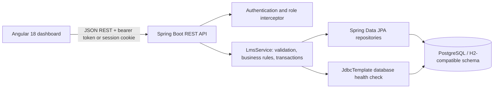
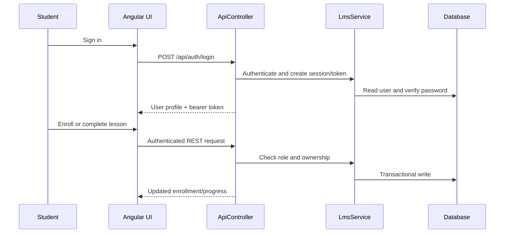

# GU_LMS Architecture and Design

## Problem and solution

GU_LMS provides one learning workspace for three roles: administrators manage the platform, instructors manage courses and grading, and students enroll, complete lessons, and submit work.

## Architecture

## Main workflows

## Design decisions

- JPA is used for domain CRUD and transaction boundaries; `JdbcTemplate` is also demonstrated for a direct SQL connectivity check at `/api/health/database`.
- The existing bearer-token/local-storage flow remains supported. The API additionally stores the authenticated user ID in `HttpSession`, so server-side session authentication is available without breaking the Angular client.
- Role checks occur at the API interceptor and business-layer ownership checks protect student learning data.
